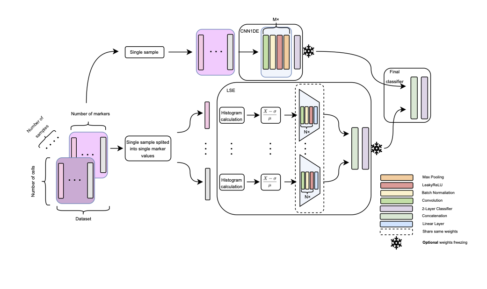

# Source code for the _CytoDNNEnsemble: Combining cell-level and distribution-level representations for flow-cytometry classification_ publication

[Paper Link](https://www.nature.com/articles/s41598-026-74128-9)

[](https://doi.org/10.5281/zenodo.22944423)

[](https://doi.org/10.5281/zenodo.22895968)

## Method

Flow cytometry is a cornerstone diagnostic technique, but manual analysis is laborious, subjective, and prone to inter-operator variability. We propose CytoDNNEnsemble, a compact deep ensemble model for automated analysis of high-dimensional flow cytometry data. The architecture consists of two smaller, independent subnetworks that process blood samples from complementary perspectives. This design may reduce reliance on expert gating and improve diagnostic consistency. Across four public benchmarks, CDE achieves higher mean accuracy and AUC than the published comparison values on AML and HEUvsUE, while performance on HVTN and NK-Cell is comparable to or below the strongest reported baseline. These findings indicate that the benefit of feature fusion is dataset dependent and warrants validation under fully controlled benchmark implementations and external cohorts.



Overview of the CytoDNNEnsemble (CDE) model. Each sample with dimensionality [num_cells, num_markers] is processed independently from two different perspectives. In the upper branch, the 1D Convolutional Neural Network Extractor (CNN1DE) processes the sample row by row using marker values of individual cells. In the lower branch, the Latent Space Extractor (LSE) separates marker-wise values (columns), computes and normalizes their histograms, and obtains latent representations using a pretrained convolutional encoder; these representations are concatenated and used for classification. The predictions of CNN1DE and LSE are concatenated and passed to a final classifier, which produces the final decision. CNN1DE and LSE are trained independently; during the final training stage, the weights of these subnetworks can either be frozen or the entire pipeline can be trained end-to-end. This design enables the ensemble to capture fine-grained cell-level information (CNN1DE) and global marker-level trends (LSE) within a single architecture. For simplicity, the scheme is illustrated for a single sample; in practice, all computations are performed in a batch-wise manner.

## How to run
All the scripts that provide training all the models from the publication are in `experiments` folder.

### Single models
For example to train the `CNN1DE` model on AML data you must run:
```
cd experiments/ex_1_single_extractors/AML
python train_AML_cnn_1d_extractor.py
```

### CDE model
To train the final `CDE` model on AML data (with pretrained LSE and CNN1DE models) you must run:
```
cd experiments/ex_2_final_models/AML
python train_AML_final_model_clf_best.py
```

## Helpful code
We rely on the [CytoSet](https://github.com/CompCy-lab/cytoset) source code for fair comparsion.

## Citation
```
@article{Gniazdowski2026,
  author  = {Gniazdowski, Tomasz and Markowska-Kaczmar, Urszula},
  title   = {{CytoDNNEnsemble}: combining cell-level and distribution-level representations for flow-cytometry classification},
  journal = {Scientific Reports},
  year    = {2026},
  date    = {2026-10-12},
  issn    = {2045-2322},
  doi     = {10.1038/s41598-026-74128-9},
  url     = {https://doi.org/10.1038/s41598-026-74128-9}
}
```
